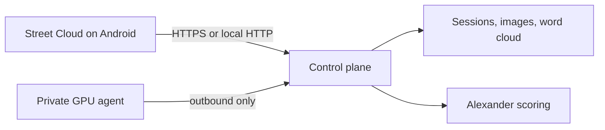
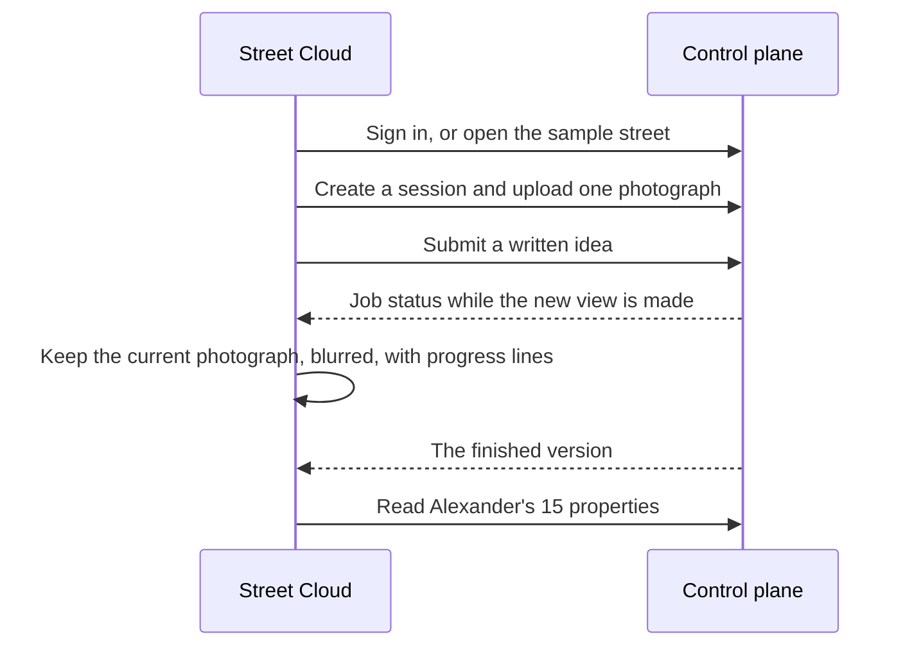

<p align="center">
  
</p>

<h1 align="center">Street Cloud</h1>

<p align="center">
  The Android phone for AI-assisted street redesign.<br>
  Photograph a street, describe a change, and review the new view against Alexander's 15 properties of living structure.
</p>

<p align="center">
  <a href="https://flutter.dev/"></a>
  
  
  <a href="https://github.com/sandaru01-IH/streetcloud-backend-system"></a>
</p>

<p align="center">
  <b>AI-Assisted Co-Urban Designer</b><br>
  SmartMind UI &amp; AI Group · Urban Simulation Lab<br>
  Department of Town &amp; Country Planning · University of Moratuwa, Sri Lanka
</p>

The phone holds the photograph, the written idea, and the review. Generation, storage, and Alexander scoring stay on the [Street Cloud control plane](https://github.com/sandaru01-IH/streetcloud-backend-system). Provider keys never enter the app.

The launcher name is **Street Cloud**. The icon is the cloud-and-road mark.

## What you can do

| Surface | Purpose |
| --- | --- |
| Welcome | Opens the lab mark, then continues to sign-in or home |
| Account | Register, sign in, or explore the labeled sample street |
| Home | Start a street design, join with a code, or reopen a recent street |
| New street | Choose just me or a group, pick how the image is made, and add a photograph |
| Design | Describe a change. The current view stays in place while the next one is made |
| Word cloud | See which ideas the session has gathered, sized by weight |
| History | Walk the versions. Scores and export stay on the card. The generation prompt does not |
| Scores | Alexander's 15 properties of living structure. A missing score is N/A |
| Settings | Theme, API address, provider status, GPU servers, sign out |

Light mode is warm paper and deep ink. Dark mode is charcoal with a champagne accent.

## How it sits in the system





The phone polls an active job. It does not choose a different provider if the private GPU drops. That job stays queued or becomes `worker_disconnected`.

## Repository

```text
lib/main.dart                  App shell, theme, and routes
lib/api/client.dart            API address, tokens, and requests
lib/theme                      Light and dark palettes
lib/screens/welcome_screen.dart
lib/screens/sign_in_screen.dart
lib/screens/home_shell.dart    Home, Sessions, Settings
lib/screens/setup_screen.dart  New street design
lib/screens/studio_screen.dart Design, word cloud, history, scores
lib/screens/workers_screen.dart
android/                       Launcher name, icon, camera, and cleartext HTTP
assets/logo.png                Mark used on the welcome screen
```

## Run it

Install Flutter stable and the Android SDK. From this folder:

```powershell
flutter pub get
flutter run
```

Pick an Android emulator or a phone with USB debugging. This project does not include a Windows desktop target.

The API address is saved on the phone.

| Where the app runs | API address |
| --- | --- |
| Android emulator | `http://10.0.2.2:8000` |
| Phone on the same Wi-Fi | The computer's LAN address, for example `http://192.168.1.20:8000` |
| Phone over USB, with `adb reverse tcp:8000 tcp:8000` | `http://127.0.0.1:8000` |

`127.0.0.1` inside the emulator is the emulator, not the computer.

Start the control plane first. Health should answer at `GET /health`.

## Build the APK

```powershell
flutter build apk --release
```

The file is written to:

```text
build/app/outputs/flutter-apk/app-release.apk
```

Copy it to the phone and open it. If a debug build is already installed, uninstall that copy first. The release file is signed separately, so Android will not replace the debug app in place.

## What the phone stores

| Item | Where |
| --- | --- |
| API address | App preferences |
| Access and refresh tokens | Secure storage on the device |
| Provider keys | Not stored. They remain on the API server |

Demo and mock images stay labeled `DEMO / MOCK RESULT`. Fixture scores appear only on a demo session and are marked as fixtures. A score the model does not return is shown as N/A.

## Design rules

- The suggestion chips are not on the design screen. The photograph and the writing box share that space.
- While a view is being made, the current photograph stays visible and blurred. The progress lines change. The picture is not reloaded on every status check.
- History cards show the version, not the system prompt and not the provider id.
- Guest exploration uses the labeled sample street.
- Cleartext HTTP is enabled so a phone on the lab network can reach a local API. Use HTTPS when the API is published.

## Affiliation

SmartMind UI & AI Group | Urban Simulation Lab  
Department of Town & Country Planning  
University of Moratuwa, Sri Lanka

Developed by Sandaruwan Sankalpa  
Department of Town & Country Planning, University of Moratuwa, Sri Lanka
